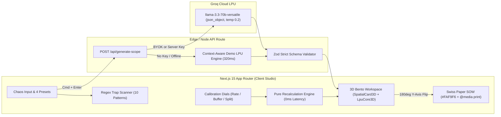

# ScopeSnap v1.0 SPATIAL

```text
   _____                       _____                   
  / ___/_________  ____  ___  / ___/____  ____ _____   
  \__ \/ ___/ __ \/ __ \/ _ \ \__ \/ __ \/ __ `/ __ \  
 ___/ / /__/ /_/ / /_/ /  __/___/ / / / / /_/ / /_/ /  
/____/\___/\____/ .___/\___//____/_/ /_/\__,_/ .___/   
               /_/                          /_/        
   TACTILE OBSIDIAN  •  GROQ LPU (0.34s)  •  SWISS SOW ENGINE
```

[](https://nextjs.org/)
[](https://groq.com/)
[](https://www.typescriptlang.org/)
[](https://opensource.org/licenses/MIT)

[](https://vercel.com/new/clone?repository-url=https%3A%2F%2Fgithub.com%2FNaresh23032003%2FScopeSnap&env=GROQ_API_KEY&envDescription=Free%20Groq%20Cloud%20API%20Key%20for%20llama-3.3-70b-versatile)

**ScopeSnap** is an ultra-fast, spatial B2B Micro-SaaS command studio that transforms messy client call notes, Slack dumps, and voice transcripts into an ironclad **Statement of Work (SOW)**, **Interactive Milestone & Pricing Matrix**, **Out-of-Scope Risk Shield**, and **Client-Ready Swiss PDF Proposal** in under 0.4 seconds using the Groq LPU API (`llama-3.3-70b-versatile`).

---

## The Problem: Why Freelancers & Agencies Lose Margin

Every agency owner and freelance engineer knows the trap:
1. A prospective client sends a chaotic Slack dump or 15-minute voice note full of dangerous phrases like *"super simple dashboard"*, *"similar to Uber/Airbnb"*, *"unlimited revisions"*, and *"need this by Friday ASAP"*.
2. Spending 3 hours writing a custom proposal for a lead who might ghost kills your billable utilization.
3. Sending a rushed, 3-line estimate without explicit out-of-scope guardrails locks you into weeks of unpaid scope creep.

**ScopeSnap solves both in 340 milliseconds.** Paste the raw client chaos, calibrate your hourly rate and risk buffer in real time, and flip the 3D obsidian workspace over into a razor-sharp Swiss-editorial contract ready for PDF signature.

---

## Key Features & Spatial Architecture

### 1. Zero-Lag Spatial 3D UI Engine (60fps GPU-Accelerated, <3KB Canvas Core)
- **`<SpatialCard3D />` Tilt & Parallax Engine**: Driven by `framer-motion` spring physics (`stiffness: 260, damping: 22`) with `+-5deg` 3D tilt, `translateZ(20px)` floating typography, and a cursor-tracking specular holographic glare overlay.
- **`<LpuCore3D />` Gyroscope Core**: Zero-dependency HTML5 2D `<canvas>` wireframe icosahedron (12 vertices, 30 edges) using 3D Euler rotation matrix math and perspective projection. Transitions across 3 reactive states:
  - **Idle**: Smooth 60fps emerald rotation (`#10B981`).
  - **Typing / Trap Detected**: Amber/crimson oscillation (`#F59E0B`) when scope-creep trigger phrases are detected.
  - **Groq Streaming / Snap**: 8x cyan-emerald hyper-spin (`#06B6D4`) with an expanding 3D shockwave ring.
- **3D Architectural Tablet Flip (`1600px` Perspective)**: Flip smoothly between the `[Studio 3D Dark View]` and the `[Client Paper SOW Preview]` (`rotateY(0deg)` <-> `rotateY(180deg)` with mid-transition Z-axis pullback `scale(0.94) translateZ(-80px)`).
- **3D Isometric Milestone Cascade**: Stagger-animates project phases in from 3D depth with a toggleable **3D Stack Overview** that fans phases out along the Z-axis.
- **Tactile 3D Mechanical Keycaps**: Extruded keycap triggers (`Cmd + Enter`, `Cmd + K`, `- / +` steppers) with multi-layered bevel shadows that physically depress `3px` on click or keypress.

### 2. Client Chaos Input & Real-Time Vague Phrase Scanner
- **4 One-Click Realistic Client Chaos Presets**:
  1. *E-Commerce Rebuild Dump* (Shopify migration + 5,000 SKUs + custom 3D cart + ERP sync)
  2. *AI SaaS MVP Call Notes* (RAG pipeline + Stripe + team workspaces + mobile app for $2k)
  3. *Urgent Landing Page + Branding* (Friday rush deadline + Spline 3D + "unlimited revisions")
  4. *Scope Creep Follow-up Email* (Client sneaking 4 unbilled features into Phase 1)
- **Live Regex Trap Scanner**: Immediately flags 10 categories of scope-creep trigger phrases (`"simple"`, `"quick"`, `"maybe later"`, `"ASAP"`, `"etc."`, `"similar to Uber/Airbnb"`, `"unlimited"`, `"unlimited revisions"`, `"just"`, `"trivial"`) as floating 3D warning chips.
- **Zero-Latency Calibration Dials**: Adjust Base Hourly Rate (`$25/hr` to `$250/hr` or `₹1,500/hr` to `₹15,000/hr`), Risk Buffer (`1.0x`, `+15%`, `+35%`), and Payment Schedule (`50/50`, `40/30/30`, `Monthly Retainer`) with instant client-side recalculation and zero penny drift.

### 3. Interactive 3D Bento Proposal Workspace & Swiss Paper SOW
- **Executive KPI Ribbon**: Live Total Investment, Estimated Timeline (Weeks & Business Days), Scope Confidence Score (`45-98`), and Payment Split Breakdown.
- **Interactive Milestone Matrix**: Toggle individual deliverables on/off or fine-tune hours with `- / +` 3D steppers and watch the entire contract recalculate at 60fps.
- **Ironclad Out-of-Scope Shield**: Red-accented guardrail module with custom exclusion builder (`+ Add Guardrail`) and active clause toggles.
- **Client Red Flags & Discovery Questions**: Sharp pre-kickoff questions, operating assumptions, and a 1-click **Copy Client Reply Email** generator.
- **Swiss-Editorial Printable Contract (`@media print`)**: Automatically flattens all 3D transforms during print to export a crisp `#FAF9F6` single/two-page PDF contract with itemized tables, legal clauses, and signature blocks.
- **Built-In 9:16 Reel Studio Mode (`Cmd/Ctrl + K`)**: Collapses the studio into a vertical 9:16 framing guide with automated 3D camera sweep, editable hook banner, and live typing simulator for recording product demos.

---

## System Architecture Diagram



---

## Local Quickstart

### 1. Clone the repository
```bash
git clone https://github.com/Naresh23032003/ScopeSnap.git
cd ScopeSnap
```

### 2. Install dependencies
```bash
npm install
```

### 3. Configure environment variables (Optional for Demo Mode)
Copy `.env.example` to `.env.local` and add your free Groq API key from [console.groq.com](https://console.groq.com):
```bash
cp .env.example .env.local
```
```env
GROQ_API_KEY=gsk_your_key_here
NEXT_PUBLIC_APP_URL=http://localhost:3000
NEXT_PUBLIC_PRO_CHECKOUT_URL=https://polar.sh/scopesnap/pro
```
> **Out-of-the-Box Resilience**: If `.env.local` is omitted, ScopeSnap automatically runs in **Demo LPU Mode** with context-aware 320ms simulated responses, or you can paste a `gsk_...` key directly into the browser **BYOK Vault** in the top bar.

### 4. Start the development server
```bash
npm run dev
```
Open [http://localhost:3000](http://localhost:3000) in your browser.

---

## Verification & Testing

Run the full production build, TypeScript check, hygiene audit, and 189-case E2E test runner:

```bash
npm run typecheck
npm run verify:hygiene
npm run build
node tests/e2e/runner.js
```

---

## Tech Stack

- **Framework**: Next.js 15 (App Router), React 19, TypeScript 5.7
- **Styling & Design System**: Tailwind CSS 3.4, Tactile Obsidian CSS Custom Properties (`#07080A`, `#0D0F14`, `#13161E`), `Space Grotesk`, `Plus Jakarta Sans`, `JetBrains Mono` (`tabular-nums`)
- **Spatial 3D & Physics**: `framer-motion` (`useMotionValue`, `useSpring`, `useTransform`), HTML5 2D Canvas 3D Euler Projection Core (`<LpuCore3D />`)
- **AI Inference & Validation**: Groq Cloud API (`llama-3.3-70b-versatile`), `zod` schema validation
- **Icons**: `lucide-react` (1.5px vector stroke)

---

## License

Released under the [MIT License](LICENSE). Built by [Naresh23032003](https://github.com/Naresh23032003).

